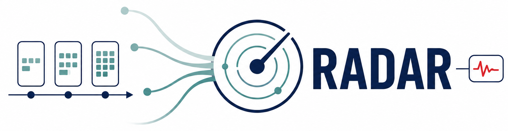

<p align="center">
  
</p>

# RADAR

RADAR (**R**isk **A**ssessment via **D**ecay-weighted **A**ggregation of
**R**ecords) predicts the risk of future incident atrial fibrillation (AF) from longitudinal
diagnosis histories. It pools each encounter's diagnosis set, updates a set of
 memory embeddings with time-dependent decay, and estimates monthly
AF and death hazards through one year.

This repository provides the model, training and prediction scripts, a MIMIC-IV
adapter, and a synthetic demo for *Deep Learning for Population-Scale Prediction
of Incident Atrial Fibrillation*. The paper configuration is in
[`configs/paper.json`](configs/paper.json).

## Installation

Requires Python 3.10 or newer and PyTorch 2.2 or newer.

```bash
python -m venv .venv
source .venv/bin/activate
python -m pip install -e ".[test]"
pytest
```

For CUDA, install the appropriate PyTorch build before installing this package.

## Demo

```bash
bash scripts/run_demo.sh
```

This produces synthetic data following a similar format as available within MIMIC, prepares patient sequences, trains
a small model for one epoch, and writes `demo_run/predictions/predictions.csv`.
No external data are needed.

## MIMIC-IV

Obtain [MIMIC-IV v3.1](https://physionet.org/content/mimiciv/3.1/) through
PhysioNet after completing its credentialing and data-use requirements. The
adapter reads `patients`, `admissions`, `diagnoses_icd`, and `procedures_icd`
CSV files (plain or gzip-compressed) under `/path/to/mimic-iv-3.1/hosp/`.

Separately download the
[2018 ICD-10-CM GEM ZIP](https://www.cms.gov/medicare/coding/icd10/downloads/2018-icd-10-cm-general-equivalence-mappings.zip)
from the [official CMS archive](https://www.cms.gov/medicare/coding-billing/icd-10-codes/icd-10-cm-icd-10-pcs-gem-archive)
and save it locally as `data/2018_I10gem.zip`. The adapter reads the forward
ICD-10-CM → ICD-9-CM diagnosis mapping (`2018_I10gem.txt`) directly from the ZIP. Use the diagnosis GEM, not the reverse or procedure mapping.

```bash
mkdir -p data
# Save the CMS download as data/2018_I10gem.zip before preparing data.
radar-prepare-mimic \
  --mimic-dir /path/to/mimic-iv-3.1 \
  --gem data/2018_I10gem.zip \
  --out-dir prepared/mimic-radar

radar-train \
  --data-dir prepared/mimic-radar \
  --out-dir runs/mimic-radar \
  --epochs 5

radar-predict \
  --checkpoint runs/mimic-radar/checkpoint_best.pt \
  --data-dir prepared/mimic-radar \
  --split test \
  --out-dir outputs/mimic-radar-test
```

Training uses AdamW with 5% linear learning-rate warm-up followed by cosine
decay. The best checkpoint maximizes full 12-month validation AUROC among
encounters with observable binary outcomes.

Preparation uses patient-level 70/15/15 splits and learns the vocabulary and age
normalization from training patients only. AF outcome codes are removed
from model inputs; the default postoperative exclusion window is 90 days.
Predictions include diagnoses assigned during the current admission and are
retrospective encounter-level estimates. Follow-up is capped at 365 days, with
death treated as a competing event.

These commands train a MIMIC model using vocabulary and normalization learned
from its training patients. The paper's external validation applies the frozen
HCAI-trained model with its HCAI vocabulary and normalization. Dataset access
and derived outputs are governed by the provider's data-use terms. Run each
command with `--help` for options.

## Other datasets

Use the runnable [custom-data example](examples/custom_data/README.md) to adapt
RADAR to another encounter-level dataset. The [data schema](docs/data_schema.md)
describes the prepared arrays; the [model card](docs/model_card.md) summarizes
inputs, outputs, and intended use.

## Citation

If you use RADAR, please cite the accompanying manuscript:

> Alexander Schubert, Abhijith Varma Mudunuri, Marie-Laure Charpignon,
> Jean Jacques Noubiap, Ahmed Alaa, Gregory M. Marcus. **Deep Learning for
> Population-Scale Prediction of Incident Atrial Fibrillation.** Under review.

Citation details will be updated upon publication.

Please also cite MIMIC-IV when using its data:

> Johnson AEW et al. MIMIC-IV, a freely accessible electronic health record
> dataset. *Scientific Data*. 2023;10:1.

MIMIC-IV v3.1: <https://physionet.org/content/mimiciv/3.1/>

## License

Code is released under the [MIT License](LICENSE). Dataset access and use are
governed separately by the relevant data providers.
